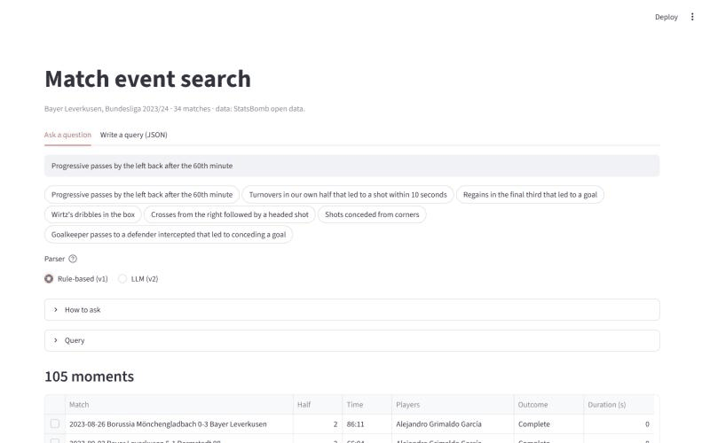
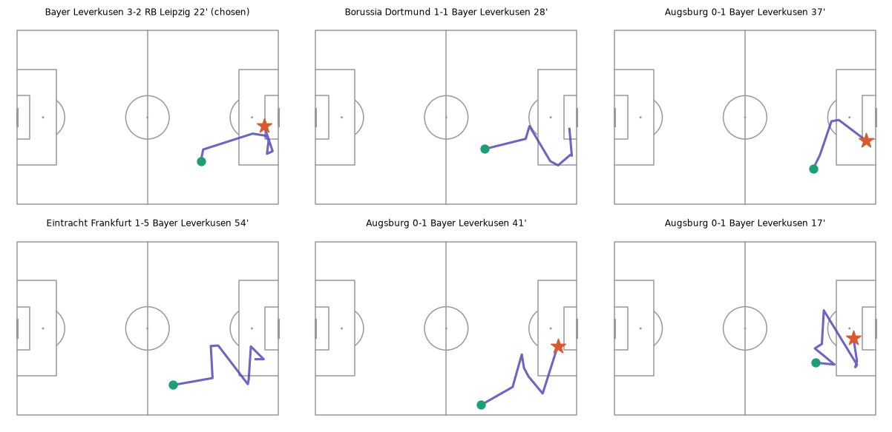

# Match Event Search

Search a season of football events with a question in plain English. An analyst types
*"turnovers in our own half that led to a shot within 10 seconds"* and gets every matching moment of Bayer
Leverkusen's 2023/24 Bundesliga season: match, minute, players, outcome, and the move on a pitch that can be stepped
through event by event. One click further, it finds the situations across the season that looked most like it.



Built on [StatsBomb open data](#data): 34 matches, 137,765 events.

## How it works

| | Step | Notes |
|---|---|---|
| 1 | **Data**: Leverkusen's unbeaten 2023/24 season (28 wins, 6 draws), events and 360 freeze-frames, kept locally after the first download | [01](docs/methodology/01_data.md) |
| 2 | **Tagging**: every event gets nine families of tags, including derived ones: progressive passes and carries, open-play turnovers and regains, box entries, phases of play | [02](docs/methodology/02_tagging.md) |
| 3 | **Graph**: a NetworkX graph of season → match → half → possession → event, with sequence edges between events | [03](docs/methodology/03_graph.md) |
| 4 | **Query format**: a JSON Schema for single events and sequences ("A, then B within N seconds"), and the engine that runs it | [04](docs/methodology/04_query.md) |
| 5 | **Rule-based parser (v1)**: plain English to JSON with an ordered lexicon, names from the data, typo correction | [05](docs/methodology/05_rule_parser.md) |
| 6 | **LLM parser (v2)**: an Anthropic model writes the same JSON; it is validated, corrected once if needed, with v1 as fallback | [06](docs/methodology/06_llm_parser.md) |
| 7 | **Evaluation**: 31 questions with expected queries, written before either parser saw them | [07](docs/methodology/07_evaluation.md) |
| 8 | **Interface**: a Streamlit page with results, pitch plots and an event-by-event stepper | [08](docs/methodology/08_interface.md) |
| 9 | **Similar situations**: possessions as vectors of route, tempo and start, and their nearest neighbours | [09](docs/methodology/09_similarity.md) |

[`notebooks/demo.ipynb`](notebooks/demo.ipynb) walks through all of it on one moment.

## From law to football
The design comes from my earlier project, a knowledge-graph model of Dutch statutory law
([article-relationship-model](https://github.com/robinAssam/article-relationship-model)), which breaks articles into
atoms, labels them with a 9-label schema, connects them through three edge channels and places plain-language
questions in the legal tree.

| Law project | Football version |
|---|---|
| Articles → atoms | Match → individual events (pass, carry, shot, tackle, …) |
| 9-label schema | Nine tag families: action, zone, phase of play, role, pressure, outcome, game state, time, team |
| Legal hierarchy | Season → match → half → possession → event |
| Edge channels: hierarchical containment, semantic similarity, tag overlap | `contains`, `similar` (possessions), tag filters; plus `next` and `same_player` for sequences |
| Question → position in the tree | Plain-language question → JSON query over the graph |

## Tags
| Family | Examples |
|---|---|
| Action | pass, carry, shot, tackle, …; cross, through ball, switch, key pass, header; **progressive** (Wyscout's 30/15/10 m rule), **turnover**, **regain**, **box entry** |
| Zone | third, channel (wings, half-spaces, centre), half, the box attacked and the own box, also for the end of passes and carries |
| Phase | build-up, progression, final third, transition, counter-attack, set piece; counterpress, high press, mid and low block |
| Role | position, role group (GK, CB, FB incl. wing backs, DM, CM, AM, W, ST), side; also for the intended receiver of a pass |
| Pressure, outcome, game state, time, team | under pressure, success or failure and detail, winning/drawing/losing before the event, minute and 15-minute window, our team or the opponent |

Coordinates are stored from the acting team's side, so "attacking third" means the same for both teams; the plots
turn the opponent's events round to show both on one pitch.

## Query format
```json
{"sequence": [
  {"filter": {"turnover": true, "our_team": true, "half": "own"}},
  {"filter": {"action": "shot"}, "team": "other", "within_s": 10}
]}
```
A filter is a set of conditions on the tags; a sequence step is searched among the events after the previous one,
within a time limit or the same possession, by the same or the other team, and stops when the ball goes dead. The
schema rejects misspelt values with a message saying what to fix. This query finds 18 moments in the season.

## Evaluation
31 questions with expected queries, written and approved before either parser saw them. A parser is correct when its
query finds exactly the same moments as the expected one.

| Parser | Correct | Exact query |
|---|---|---|
| Rule-based (v1, baseline) | 19 / 31 (61%) | 17 / 31 (55%) |
| LLM (v2: Anthropic's Opus 5.5, medium effort) | **30 / 31 (97%)** | 27 / 31 (87%) |
| LLM with fallback to v1 | 30 / 31 (97%) | 27 / 31 (87%) |

- The LLM parser handled the paraphrases ("found a teammate", "balls won high up the pitch"), the negation, the point
  of view ("shots we conceded while we were winning") and the misspelt name that the rules miss.
- Its one miss is the question the format cannot express ("passes that broke the opposition's midfield line"): it
  approximated it instead of saying so.
- Two runs gave the same verdict on every question; a run of all 31 questions costs about $0.13.
- Every wrong v1 answer came with a "words not used" warning (12 of 12), against 1 of the 19 correct ones.

## Similar situations
For Leverkusen's opening goal of the season (Leipzig, 22:55: Xhaka's regain, Frimpong's goal 9 s later), the ten most
similar possessions are all quick attacks after a regain: 9 reached the box, 5 ended in a shot, none in a goal.
Neighbours start the same way 96.8% of the time (24.7% by chance), and although the outcome is not part of the
comparison, neighbours of possessions that ended in a shot end in a shot 37.9% of the time, against 10.7% otherwise.



## Quick start
Requires Python 3.11+.

```bash
python -m venv .venv
.venv\Scripts\activate              # Windows; macOS/Linux: source .venv/bin/activate
pip install -r requirements.txt
pip install -e .
python scripts/download_data.py     # ~400 MB of StatsBomb open data into data/raw/ (--limit 3 for a quick start)
pytest
```

Then:

```bash
streamlit run app/app.py                                         # the search page
python scripts/ask.py "Wirtz's dribbles in the box"              # one question in the terminal
python scripts/evaluate.py                                       # the evaluation (add --llm for v2)
python scripts/find_similar.py                                   # similar situations, with a figure
```

The LLM parser uses the API key of whoever runs the code; set your own `ANTHROPIC_API_KEY` and the model id in
`LLM_MODEL`. Without them, questions go to the rule-based parser.

## Project structure
```
app/                    Streamlit page
docs/methodology/       one short note per step (01-09)
evaluation/             the 31 approved questions and their expected queries
notebooks/demo.ipynb    walkthrough
outputs/                evaluation results, figures
scripts/                download, ask, search, evaluate, find similar, summaries
src/match_event_search/ loaders, tagging, graph, query, rule_parser, llm_parser, evaluation, similarity, plotting
tests/                  pytest; tests that need the data are skipped when it is not downloaded
```

## Data


Data provided by [StatsBomb](https://statsbomb.com/) through its [open-data repository](https://github.com/statsbomb/open-data),
used under the terms of the StatsBomb open data licence. Three matches have 360 files that do not link to their events;
see the [data notes](docs/methodology/01_data.md).

## Licence
MIT, see [LICENSE](LICENSE). The data remains subject to StatsBomb's licence.
